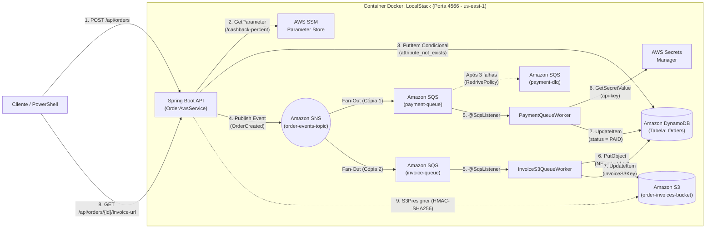
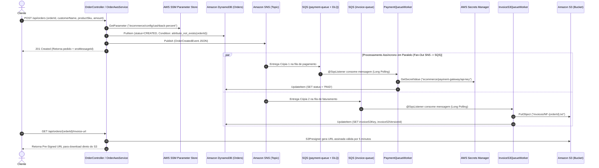

# Laboratório Prático AWS & System Design: Arquitetura Orientada a Eventos com LocalStack (`CLF-C02`)

Este projeto é um laboratório prático executável em **Java 21 + Spring Boot 3.4 + Spring Cloud AWS 3.3 + LocalStack** que implementa uma arquitetura completa de E-Commerce **Cloud-Native e Serverless** rodando 100% localmente via Docker, cobrindo os principais serviços e conceitos cobrados na certificação **AWS Certified Cloud Practitioner (`CLF-C02`)** e em entrevistas de **System Design**.

---

## Sumário

1. [Arquitetura Completa & Diagrama de Sequência](#1-arquitetura-completa--diagrama-de-sequência)
2. [Guia de Estudos AWS (`CLF-C02`): O Papel de Cada Serviço no Projeto](#2-guia-de-estudos-aws-clf-c02-o-papel-de-cada-serviço-no-projeto)
   - [2.1 Bootstrapping & Infraestrutura como Código (`ready.d` / EC2 User Data)](#21-bootstrapping--infraestrutura-como-código-readyd--ec2-user-data)
   - [2.2 Amazon SNS vs. Amazon SQS & O Padrão Fan-Out + DLQ](#22-amazon-sns-vs-amazon-sqs--o-padrão-fan-out--dlq)
   - [2.3 AWS SSM Parameter Store vs. AWS Secrets Manager](#23-aws-ssm-parameter-store-vs-aws-secrets-manager)
   - [2.4 Amazon DynamoDB: Serverless, Partition Key e Idempotência](#24-amazon-dynamodb-serverless-partition-key-e-idempotência)
   - [2.5 Amazon S3: Object Storage, Versioning e Pre-Signed URLs](#25-amazon-s3-object-storage-versioning-e-pre-signed-urls)
   - [2.6 Como o LocalStack Roteia Chamadas na Porta `4566` (Headers AWS SigV4)](#26-como-o-localstack-roteia-chamadas-na-porta-4566-headers-aws-sigv4)
   - [2.7 Autenticação na AWS Real: IAM Roles vs. Credenciais Fixas](#27-autenticação-na-aws-real-iam-roles-vs-credenciais-fixas)
3. [Estrutura de Arquivos do Projeto](#3-estrutura-de-arquivos-do-projeto)
4. [Como Configurar e Subir o Ambiente](#4-como-configurar-e-subir-o-ambiente)
5. [Roteiro de Testes Práticos (Passo a Passo)](#5-roteiro-de-testes-práticos-passo-a-passo)

---

## 1. Arquitetura Completa & Diagrama de Sequência

### Topologia dos Serviços AWS no LocalStack



### Fluxo Temporal Passo a Passo (Diagrama de Sequência)



---

## 2. Guia de Estudos AWS (`CLF-C02`): O Papel de Cada Serviço no Projeto

### 2.1 Bootstrapping & Infraestrutura como Código (`ready.d` / EC2 User Data)
- **Onde está no projeto:** [`docker-compose.yml`](./docker-compose.yml) e [`localstack-init/01-provision-aws-resources.sh`](./localstack-init/01-provision-aws-resources.sh).
- **Como funciona:** Mapeamos a pasta `./localstack-init` no diretório `/etc/localstack/init/ready.d` do container. Assim que o LocalStack atinge o estado `READY`, ele executa automaticamente o script `.sh` provisionando S3, DynamoDB, SQS, SNS, SSM e Secrets Manager.
- **Como cai na prova `CLF-C02`:**
  - Executar scripts automaticamente na primeira inicialização de um servidor/ambiente é chamado de **Bootstrapping**.
  - No **Amazon EC2**, esse recurso se chama **EC2 User Data (Dados do Usuário)**.
  - Para provisionar infraestrutura na AWS usando arquivos declarativos (YAML/JSON) como código, o serviço nativo da AWS é o **AWS CloudFormation**.

---

### 2.2 Amazon SNS vs. Amazon SQS & O Padrão Fan-Out + DLQ
- **Onde está no projeto:** [`01-provision-aws-resources.sh`](./localstack-init/01-provision-aws-resources.sh), [`OrderAwsService.java`](./src/main/java/com/leonardonogueira/awslab/service/OrderAwsService.java), [`PaymentQueueWorker.java`](./src/main/java/com/leonardonogueira/awslab/workers/PaymentQueueWorker.java) e [`InvoiceS3QueueWorker.java`](./src/main/java/com/leonardonogueira/awslab/workers/InvoiceS3QueueWorker.java).

| Característica | Amazon SNS (Simple Notification Service) | Amazon SQS (Simple Queue Service) |
|---|---|---|
| **Analogia** | **Megafone** (Roteador de Passagem) | **Caixa de Correio / Fila de Banco** |
| **Modelo** | **Push (Pub/Sub)** — Empurra para todos os inscritos | **Pull (Polling)** — Consumidor busca na fila |
| **Destinatários** | **1 para Muitos** (Todos os inscritos recebem cópia) | **1 para 1** (Apenas 1 worker processa e apaga a mensagem) |
| **Armazenamento** | **Não armazena** mensagens | **Armazena por até 14 dias** (padrão: 4 dias) |
| **Operação da API** | `Publish` | `SendMessage` / `ReceiveMessage` / `DeleteMessage` |

- **Por que usamos `SNS -> SQS` (Fan-Out) e nunca uma fila SQS única para dois serviços diferentes?**
  - Porque no SQS, assim que o `PaymentQueueWorker` lê e processa a mensagem, o Spring envia um `DeleteMessage` apagando a mensagem da fila. Se o `InvoiceS3QueueWorker` lesse da mesma fila, ele nunca receberia o pedido!
  - Publicando **1 vez no Tópico SNS**, o SNS multiplica (*Fan-Out*) uma cópia independente para a `payment-queue` e outra para a `invoice-queue`.
- **O que é a Dead-Letter Queue (`payment-dlq`)?**
  - Configuramos a `payment-queue` com uma `RedrivePolicy` (`maxReceiveCount = 3`). Se uma mensagem falhar 3 vezes seguidas no [`PaymentQueueWorker.java`](./src/main/java/com/leonardonogueira/awslab/workers/PaymentQueueWorker.java), o próprio SQS a move automaticamente para a fila `payment-dlq` para isolamento e análise sem travar a fila principal.

---

### 2.3 AWS SSM Parameter Store vs. AWS Secrets Manager
- **Onde está no projeto:** [`OrderAwsService.java`](./src/main/java/com/leonardonogueira/awslab/service/OrderAwsService.java) (lê `/ecommerce/config/cashback-percent` do SSM) e [`PaymentQueueWorker.java`](./src/main/java/com/leonardonogueira/awslab/workers/PaymentQueueWorker.java) (lê `ecommerce/payment-gateway/api-key` do Secrets Manager).

| Característica | AWS SSM Parameter Store | AWS Secrets Manager |
|---|---|---|
| **Uso Ideal** | Configurações, Feature Flags (`/ecommerce/config/cashback-percent`), URLs, IDs de AMIs | Credenciais críticas, **senhas de banco RDS/Aurora**, chaves de API |
| **Custo** | **100% Gratuito** (Standard Tier até 10.000 parâmetros) | **Pago** (US$ 0,40 por segredo/mês + chamadas de API) |
| **Rotação Automática de Senha?** | ❌ Não possui nativa | ✅ **Sim! Rotação automática nativa** (integrada com RDS, Aurora, Redshift, DocumentDB) |
| **Criptografia (AWS KMS)** | Opcional (`String`, `StringList` ou `SecureString`) | **Obrigatória por padrão** |

---

### 2.4 Amazon DynamoDB: Serverless, Partition Key e Idempotência
- **Onde está no projeto:** [`OrderAwsService.java`](./src/main/java/com/leonardonogueira/awslab/service/OrderAwsService.java).
- **Conceitos de Prova e Arquitetura:**
  1. **NoSQL Serverless (`PAY_PER_REQUEST`):** Não exige provisionar servidores nem definir esquema fixo de colunas antecipadamente (apenas a chave primária `orderId`).
  2. **`GetItem` / `Query` vs. `Scan`:** Buscar pela Partition Key (`orderId`) com `GetItem` tem **latência de milissegundos de um dígito** em qualquer escala. Já o `Scan` varre a tabela inteira (mais lento e consome mais capacidade).
  3. **Escrita Condicional Idempotente (`ConditionExpression`):**
     ```java
     dynamoDbClient.putItem(PutItemRequest.builder()
             .tableName("Orders")
             .item(item)
             .conditionExpression("attribute_not_exists(orderId)")
             .build());
     ```
     Garante atomicamente no DynamoDB que um mesmo `orderId` nunca seja salvo ou publicado no SNS duas vezes!

---

### 2.5 Amazon S3: Object Storage, Versioning e Pre-Signed URLs
- **Onde está no projeto:** [`InvoiceS3QueueWorker.java`](./src/main/java/com/leonardonogueira/awslab/workers/InvoiceS3QueueWorker.java) e [`OrderAwsService.java`](./src/main/java/com/leonardonogueira/awslab/service/OrderAwsService.java).
- **Conceitos de Prova e Arquitetura:**
  1. **S3 vs. EBS vs. EFS:**
     - **Amazon S3:** Armazenamento de **Objetos** (arquivos, PDFs, notas fiscais, fotos, backups) acessado via HTTP/API com **11 noves (`99,999999999%`) de durabilidade**.
     - **Amazon EBS (Elastic Block Store):** Disco de bloco virtual conectado a **uma única instância EC2** por vez.
     - **Amazon EFS (Elastic File System):** Sistema de arquivos de rede (NFS) que pode ser montado em **dezenas de instâncias EC2 simultaneamente**.
  2. **S3 Versioning:** Habilitado no nosso bucket `order-invoices-bucket`. Gera um `VersionId` para cada upload e protege contra exclusão ou sobrescrita acidental.
  3. **S3 Pre-Signed URL (URL Pré-Assinada):**
     - Permite que o cliente baixe um arquivo de um **Bucket S3 privado** por tempo limitado (**5 minutos** / `X-Amz-Expires=300`) usando uma assinatura criptográfica `HMAC-SHA256` na própria URL.
     - **Vantagem de System Design:** O download ocorre direto entre o navegador do cliente e o Amazon S3, sem consumir memória RAM ou banda de rede do servidor Spring Boot!

---

### 2.6 Como o LocalStack Roteia Chamadas na Porta `4566` (Headers AWS SigV4)
Todas as chamadas apontam para `http://localhost:4566`. O LocalStack identifica para qual serviço entregar lendo os cabeçalhos HTTP injetados automaticamente pelo **AWS SDK v2**:
- **`Authorization: AWS4-HMAC-SHA256 Credential=test/.../us-east-1/<servico>/aws4_request`** (onde `<servico>` é `ssm`, `dynamodb`, `sns`, `sqs`, `s3` ou `secretsmanager`).
- **`X-Amz-Target`:** Ex.: `AmazonSSM.GetParameter` ou `DynamoDB_20120810.PutItem`.

---

### 2.7 Autenticação na AWS Real: IAM Roles vs. Credenciais Fixas
No [`application.yml`](./src/main/resources/application.yml), usamos `access-key: test` e `secret-key: test` apenas porque estamos no LocalStack local.
> **Regra de Ouro da Prova `CLF-C02`:** Na AWS real, você **NUNCA** salva `access-key` e `secret-key` dentro do código ou de arquivos de configuração em servidores! Para uma aplicação rodando em **EC2, ECS ou AWS Lambda** acessar S3, DynamoDB ou SQS com segurança, você deve anexar uma **IAM Role (Função do IAM)** ao recurso computacional (que fornece credenciais temporárias automáticas via **AWS STS**).

---

## 3. Estrutura de Arquivos do Projeto

- [`docker-compose.yml`](./docker-compose.yml) — Container `localstack/localstack-pro:latest` na porta `4566`.
- [`localstack-init/01-provision-aws-resources.sh`](./localstack-init/01-provision-aws-resources.sh) — Script de Bootstrapping (`awslocal`) que cria o Bucket S3, Tabela DynamoDB, Filas SQS + DLQ, Tópico SNS (Fan-Out), SSM Parameter e Secret.
- [`src/main/resources/application.yml`](./src/main/resources/application.yml) — Configuração da porta `8081` e conexão com o LocalStack.
- [`src/main/java/com/leonardonogueira/awslab/config/AwsClientConfig.java`](./src/main/java/com/leonardonogueira/awslab/config/AwsClientConfig.java) — Configuração dos beans `SsmClient`, `SecretsManagerClient`, `SqsClient` e `S3Presigner`.
- [`src/main/java/com/leonardonogueira/awslab/config/AwsStartupInspector.java`](./src/main/java/com/leonardonogueira/awslab/config/AwsStartupInspector.java) — Diagnóstico automático na inicialização e endpoint `GET /api/aws/status`.
- [`src/main/java/com/leonardonogueira/awslab/service/OrderAwsService.java`](./src/main/java/com/leonardonogueira/awslab/service/OrderAwsService.java) — Criação idempotente no DynamoDB, leitura do SSM, publicação no SNS e geração da S3 Pre-Signed URL.
- [`src/main/java/com/leonardonogueira/awslab/workers/PaymentQueueWorker.java`](./src/main/java/com/leonardonogueira/awslab/workers/PaymentQueueWorker.java) — `@SqsListener("payment-queue")`, leitura do Secrets Manager, atualização para `PAID` no DynamoDB e simulação de erro para a `payment-dlq`.
- [`src/main/java/com/leonardonogueira/awslab/workers/InvoiceS3QueueWorker.java`](./src/main/java/com/leonardonogueira/awslab/workers/InvoiceS3QueueWorker.java) — `@SqsListener("invoice-queue")`, geração e upload da Nota Fiscal no Amazon S3 e atualização do `invoiceS3Key` no DynamoDB.
- [`src/main/java/com/leonardonogueira/awslab/api/OrderController.java`](./src/main/java/com/leonardonogueira/awslab/api/OrderController.java) — Endpoints REST (`POST /api/orders`, `GET /api/orders/{id}`, `GET /api/orders/{id}/invoice-url`).

---

## 4. Como Configurar e Subir o Ambiente

### 1. Subir o LocalStack via Docker Compose
Certifique-se de ter o seu `LOCALSTACK_AUTH_TOKEN` configurado no arquivo `.env` (caso use a imagem `localstack-pro` com o **LocalStack Desktop**, ou use `localstack/localstack:latest` sem token):

```powershell
cd aws-localstack-lab
docker compose up -d
```

Verifique se o script de inicialização provisionou todos os recursos:
```powershell
docker logs aws-localstack-lab
```

### 2. Subir a Aplicação Spring Boot (Porta `8081`)
Pela IDE (abrindo [`AwsLocalstackLabApplication.java`](./src/main/java/com/leonardonogueira/awslab/AwsLocalstackLabApplication.java) e pressionando **`Shift + F9`**) ou pelo terminal:

```powershell
.\mvnw.cmd spring-boot:run
```

---

## 5. Roteiro de Testes Práticos (Passo a Passo)

### Teste 1: Criar um Pedido (SSM + DynamoDB + SNS Fan-Out + SQS + S3)
```powershell
Invoke-RestMethod -Method Post -Uri "http://localhost:8081/api/orders" -ContentType "application/json" -Body '{"orderId":"ORD-2002","customerName":"Leonardo Nogueira","productSku":"IPHONE-16-PRO","amount":8000.00}'
```

### Teste 2: Testar a Idempotência Nativa do DynamoDB (`attribute_not_exists`)
Envie o exato mesmo comando acima novamente. O DynamoDB bloqueará a sobrescrita e retornará `"idempotentReplay": true`, sem duplicar mensagens no SNS/SQS!

### Teste 3: Consultar o Pedido Processado no DynamoDB (`GetItem`)
```powershell
Invoke-RestMethod -Method Get -Uri "http://localhost:8081/api/orders/ORD-2002"
```
*(Observe que o `status` já foi atualizado para `PAID` pelo `PaymentQueueWorker` e o `invoiceS3Key` foi preenchido pelo `InvoiceS3QueueWorker`!).*

### Teste 4: Gerar a `S3 Pre-Signed URL` (5 minutos) e Abrir a Nota Fiscal
```powershell
$res = Invoke-RestMethod -Method Get -Uri "http://localhost:8081/api/orders/ORD-2002/invoice-url"
Write-Host $res.presignedUrl -ForegroundColor Yellow
Start-Process $res.presignedUrl
```

### Teste 5: Simular Falha de Pagamento e Testar a `Dead-Letter Queue (payment-dlq)`
Qualquer pedido cujo `productSku` contenha a palavra **`FAIL`** fará o `PaymentQueueWorker` lançar exceção. Após 3 tentativas (`maxReceiveCount = 3`), o próprio SQS moverá a mensagem para a fila **`payment-dlq`**:
```powershell
Invoke-RestMethod -Method Post -Uri "http://localhost:8081/api/orders" -ContentType "application/json" -Body '{"orderId":"ORD-ERRO-99","customerName":"Cliente Teste DLQ","productSku":"FAIL-CARTAO-RECUSADO","amount":500.00}'
```

### Teste 6: Alterar Configuração em Tempo Real no SSM Parameter Store (Sem Reiniciar a App!)
```powershell
# Muda o cashback de 5% (0.05) para 20% (0.20) no SSM Parameter Store:
docker exec -it aws-localstack-lab awslocal ssm put-parameter --name "/ecommerce/config/cashback-percent" --value "0.20" --type "String" --overwrite

# Cria um novo pedido de R$ 1.000,00 e veja que ele ja recebe R$ 200,00 de cashback!
Invoke-RestMethod -Method Post -Uri "http://localhost:8081/api/orders" -ContentType "application/json" -Body '{"orderId":"ORD-3003","customerName":"Leonardo Nogueira","productSku":"TV-OLED","amount":1000.00}'
```

### Comandos Úteis de Inspeção Local
- **Painel Visual Local da Aplicação:** [http://localhost:8081](http://localhost:8081)
- **Histórico Interno de Mensagens do SNS no LocalStack:** [http://localhost:4566/_aws/sns/messages](http://localhost:4566/_aws/sns/messages)


